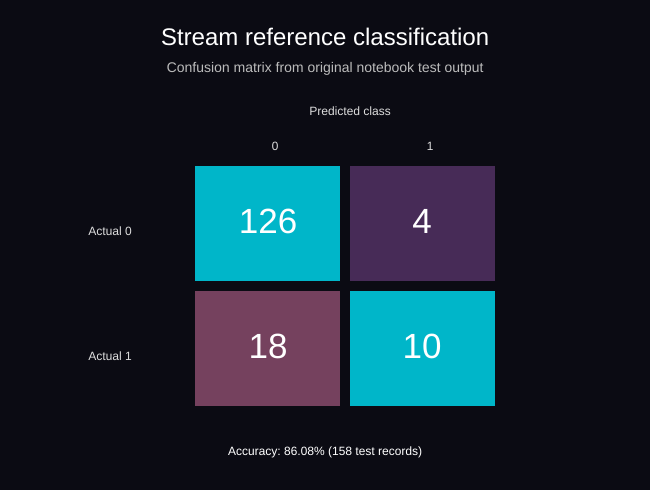
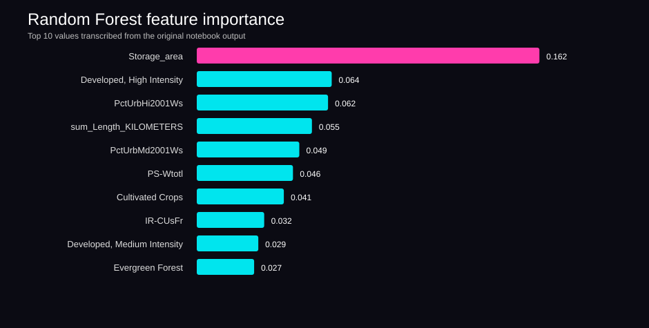

# Figures and tables

These visuals document results already present in the original Baylor notebooks, rather than presenting invented or newly fitted model outputs.

**Random Forest confusion matrix.** Counts (126, 4, 18, 10) and reported 86.08% test accuracy were transcribed from the original `Random Forest Model.ipynb` output. These results belong to the **original regressor with rounded predictions**, not the newer classifier script.

**Top predictors.** The plotted values were transcribed from the original notebook's printed feature-importance output.

**Inflection-point table:** [Candidate indices by ecoregion](ecoregion_inflection_indices.csv), transcribed from `Regression_Tree_Runs.ipynb`. These are array indices printed by the notebook, not confirmed ecological threshold values.

**Original PNG figures:** The regression notebook also contains three embedded PNG plots (cells 6, 9, and 11), and the Random Forest notebook contains a feature-importance PNG (cell 24). Run `python scripts/extract_notebook_figures.py --notebook path/to/notebook.ipynb --output-dir figures/extracted` to export those exact images. Their binary image data is not yet committed to this folder.

Source: [original Baylor notebooks](https://github.com/jayjayanton/Portfolio-Code-Examples/tree/main/Baylor%20Projects/Machine%20Learning%20Scripts). These results are historical and should not be mistaken for validation of the refactored scripts.
